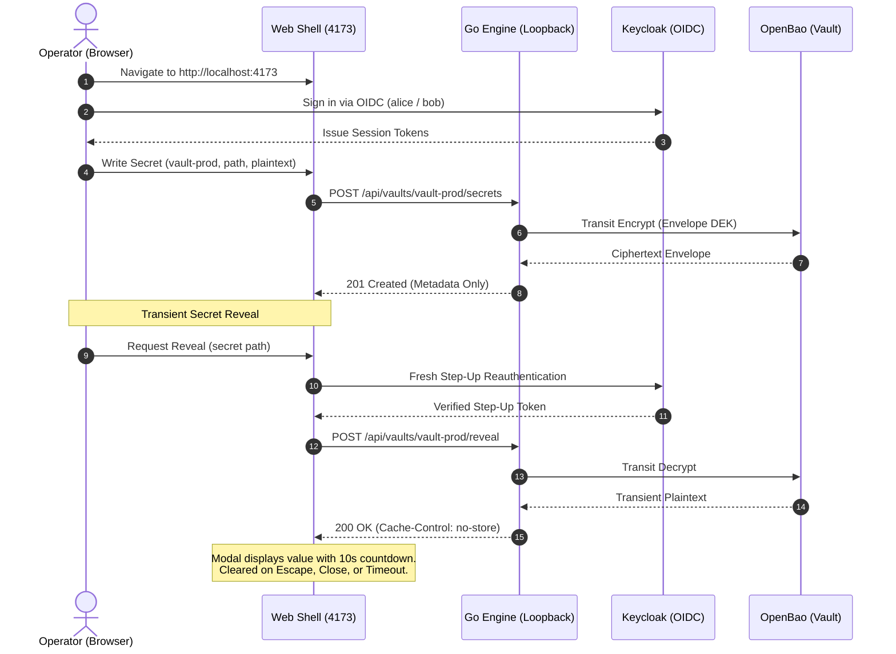

# KeyHelix User Guide

Comprehensive guide for operators, developers, and administrators running KeyHelix in local and private environments.

---

## 1. Introduction and Architectural Principles

KeyHelix is an open-source, local-first secret management and cryptographic authorization workspace. It is distributed under the [Apache-2.0 License](../../LICENSE) and designed from the ground up to eliminate mandatory cloud dependencies, paid API entitlements, and third-party SaaS infrastructure.

### Core Architectural Invariants

1. **Provider Owns Secret Bytes**: Secret payload bytes never live unencrypted on disk, in databases, or inside application memory outside of transient display. All encryption and key management is delegated directly to an isolated cryptographic engine (OpenBao via Transit and KV v2 mounts).
2. **Zero Plaintext Persistence & Zero Telemetry**: KeyHelix records only metadata envelopes and cryptographic integrity digests. The application produces zero outbound telemetry, analytic pings, or phone-home requests.
3. **Mandatory Step-Up Elevation**: Sensitive operations—including transient secret reveal, member grant modification, and key rotation—strictly require fresh OIDC step-up reauthentication.
4. **Fail-Closed Security**: If a cryptographic or identity provider encounters an outage or connectivity failure, all state-changing and data-access operations fail closed with explicit `503 Service Unavailable` status. Plaintext is never returned from cache.
5. **Loopback & Origin Isolation**: The web server and Go backend engine bind strictly to loopback interfaces (`127.0.0.1`, `::1`) with DNS rebinding defenses and same-origin protections.

---

## 2. Prerequisites and Environment

KeyHelix requires only standard, open-source development tools on a local Linux host. **No cloud account, paid subscription, public domain, or proprietary license is required.**

| Tool | Version Requirement | Purpose |
| --- | --- | --- |
| **Linux OS** | Linux x86_64 (e.g. Ubuntu 22.04 / 24.04 LTS) | Supported host operating system |
| **Node.js** | `>= 24.19.0 < 25` (npm included) | Web workspace, scripts, and supervisor |
| **Go** | `1.26.2+` (1.26.x) | Core BFF engine compilation and execution |
| **Podman** | `4.9.3+` (rootless) | Local provider container orchestration |
| **Git** | `2.34+` | Source control and version verification |

### Recommended Hardware Resources

- **CPU**: 4 vCPUs (minimum 2 vCPUs)
- **RAM**: 8192 MiB (minimum 4096 MiB)
- **Disk**: 20480 MiB free disk space (minimum 10240 MiB)

---

## 3. Installation and Source Builds

KeyHelix can be compiled and operated completely from source.

### 3.1 Clone and Initial Setup

Clone the repository and run the automated bootstrap script:

```sh
git clone https://github.com/Parsa-Emami/Keyhelix.git
cd Keyhelix
npm run setup
```

The `npm run setup` command:
1. Validates local toolchain versions (Node, Go, Podman).
2. Installs locked npm dependencies with lifecycle scripts disabled.
3. Builds the production web frontend and Go engine binary.
4. Initializes rootless Podman containers for local OpenBao (`ops/local/openbao.conf`) and Keycloak (`ops/local/keycloak-realm.json`).
5. Generates the runtime configuration and recovery credentials in `.local-data/runtime.json`.

To inspect setup actions without making changes, run:
```sh
npm run setup -- --check
```

### 3.2 Building from Source

KeyHelix components can be compiled independently:

- **Build Go Engine Binary**:
  ```sh
  npm run build:engine
  # Or natively:
  go build -trimpath -ldflags="-s -w" -o bin/keyhelix cmd/keyhelix/main.go
  ```
- **Build Web Distribution**:
  ```sh
  npm run build
  ```
  This executes type checking (`tsc -p tsconfig.json`), web metadata generation, and Vite asset compilation into `dist/web/`.

- **Produce Reproducible Release Artifacts**:
  ```sh
  npm run package
  ```
  Packages the Go engine binary, compiled web assets, offline documentation, CycloneDX SBOM, third-party notices, and SHA-256 checksums into `dist/release/`.

---

## 4. Running the Workspace and Core Workflow

### 4.1 Starting the Workspace

Start the supervised local environment:

```sh
npm start
```

This starts both the Go BFF engine on an ephemeral loopback port (`127.0.0.1:0`) and the web server at `http://localhost:4173`.

### 4.2 Core Reference Workflow

Open your browser and navigate to `http://localhost:4173`.



#### Step 1: Authentication via Local OIDC
Click **Sign in**. You will be redirected to the local Keycloak realm. Two pre-configured synthetic identities are available:
- **Alice (Vault Admin)**: `alice` / `keyhelix-local-alice` (email: `alice@keyhelix.local`)
- **Bob (Vault Member)**: `bob` / `keyhelix-local-bob` (email: `bob@keyhelix.local`)

#### Step 2: Scoped Secret Creation
1. Navigate to the **Vaults** tab (`#vaults`).
2. Select target vault `vault-prod`.
3. Provide a canonical secret path (e.g. `apps/production/database-url`) and value.
4. Click **Write Secret**.
5. The engine requests a wrapped Data Encryption Key (DEK) from OpenBao, persists only encrypted envelope metadata and an integrity digest, and reports success. Plaintext is never stored on disk.

#### Step 3: Transient Reveal with Step-Up Elevation
1. In the secret list, locate the secret and click **Reveal**.
2. If step-up credentials have expired, KeyHelix displays a step-up prompt requiring reauthentication.
3. Upon successful authentication, the transient plaintext is decrypted and displayed in a secure modal.
4. An automatic countdown timer (10 seconds) zeroes the plaintext from browser memory upon expiration.
5. Pressing <kbd>Escape</kbd> or closing the modal immediately destroys transient DOM nodes and memory references.

#### Step 4: Member Access Management & Revocation
1. Switch to the **Access & Rotations** view.
2. Select an existing user grant for `bob@keyhelix.local`.
3. Click **Revoke Grant** and confirm with step-up elevation.
4. Revocation is synchronous: any subsequent reveal attempt by Bob fails immediately with `403 Forbidden`.

#### Step 5: Key Encryption Key (KEK) Rotation
1. In the **Access & Rotations** view, initiate a KEK rotation for `vault-prod`.
2. OpenBao rotates the primary transit key version.
3. KeyHelix performs a resumable re-encryption of existing metadata envelopes without exposing secret bytes.

#### Step 6: Provider Outage Simulation
1. Stop the provider container: `npm run providers:down`.
2. Attempt to read or write a secret in the web console.
3. KeyHelix displays an explicit `503 Service Unavailable` banner.
4. Invariants are maintained: no cached plaintext is returned and requests fail closed.

---

## 5. Data Ownership, Operational Limits, and Privacy

### Data Ownership
- **Operator Authority**: All keys, envelopes, logs, and database records remain strictly on the operator's local machine or designated private host.
- **Provider Ownership**: OpenBao owns the root keys and sealed secret bytes.
- **Engine Authority**: The Go BFF engine owns metadata indexes, access grant rules, and integrity digests.

### Operational Limits
To prevent denial of service and resource exhaustion:
- **File & Structure Preview Limit**: Maximum file upload size is **1 MiB** (1,048,576 bytes).
- **Structure Depth Limit**: Maximum nested JSON parsing depth is **32 levels**.
- **Structure Key Complexity**: Maximum top-level and nested key count is **20,000 keys**.
- **Network Confinement**: Engine listens exclusively on ephemeral loopback (`127.0.0.1:0`). Foreign `Host` headers are rejected with `400 Bad Request`. Untrusted `Origin` headers on `/api/*` are rejected with `403 Forbidden`.

### Privacy Policy
- **Zero Telemetry**: No metric reporting, error reporting to external services, or automated analytics.
- **Cache Segregation**: Sensitive routes (`/`, `/healthz`, `/readyz`, `/runtime-config.json`, `/api/diagnostics`, `/api/*`) strictly emit `Cache-Control: no-store` and `Pragma: no-cache`.

---

## 6. Backup, Disaster Recovery, and Forward Repair

### 6.1 State and Storage Locations

All persistent state is stored in the local repository under `.local-data/`:
- `.local-data/runtime.json`: Operational endpoints, container ports, and scoped provider tokens.
- `.local-data/openbao/`: OpenBao file storage backend and transit key rings.
- `.local-data/keycloak/`: Keycloak H2 / local relational database files.
- `.local-data/engine/`: Engine metadata store (immutable versioned manifests).

> [!CAUTION]
> The `.local-data/` directory contains active cryptographic material and must never be committed to Git. It is excluded by `.gitignore`.

### 6.2 Backup Procedure

1. **Stop the Supervised Processes**:
   ```sh
   # Stop web and engine (Ctrl+C in running terminal)
   ```
2. **Snapshot Provider State**:
   Create a consistent archive of `.local-data/`:
   ```sh
   tar -czf "keyhelix-backup-$(date +%Y%m%d%H%M%S).tar.gz" .local-data/
   ```
3. **Store Recovery Keys Separately**:
   Securely store the OpenBao unseal keys recorded during initial setup.

### 6.3 Recovery and Forward Repair

1. **Restore from Backup**:
   Extract backup archive into a clean environment:
   ```sh
   tar -xzf keyhelix-backup-<timestamp>.tar.gz
   npm run providers
   npm start
   ```
2. **Safe Forward Repair Policy**:
   Never overwrite newer accepted state with an older backup. If metadata corruption occurs, use tested forward repair scripts (`scripts/validate_repo.py`) rather than destructive rollbacks.

---

## 7. Troubleshooting and Diagnostics

### System Health Verification

Execute the built-in diagnostic doctor:
```sh
npm run doctor
```

The doctor reports:
- Node.js, Go, and Podman versions.
- Web server build state and asset manifests.
- Go engine binary compilation status.
- Container provider status (`openbao` on port 8200, `keycloak` on port 8080).
- Runtime configuration sanity in `.local-data/runtime.json`.

### HTTP Diagnostic Endpoints

The running workspace exposes three health endpoints:
- `GET /healthz`: Basic process liveness.
- `GET /readyz`: Readiness probe asserting web and engine readiness.
- `GET /api/diagnostics`: Detailed subsystem breakdown (engine, storage, key provider, identity provider). All tokens and secrets are strictly redacted.

### Common Issues and Resolutions

1. **Port Already Occupied (`EADDRINUSE`)**:
   - Web default port: `4173`
   - OpenBao default port: `8200`
   - Keycloak default port: `8080`
   - Solution: Stop conflicting services or specify a custom port: `npm start -- --port 4301`.
2. **Podman Container Permission Denied**:
   - Ensure rootless podman is configured: `podman info`.
   - Verify subuid/subgid mapping: `cat /etc/subuid`.

---

## 8. Support and Community

- **Issue Tracker**: Submit bug reports and feature suggestions on [GitHub Issues](https://github.com/Parsa-Emami/Keyhelix/issues).
- **Discussions**: Ask questions and share architectural feedback on [GitHub Discussions](https://github.com/Parsa-Emami/Keyhelix/discussions).
- **Security Inquiries**: Follow the coordinated disclosure route documented in [SECURITY.md](../../SECURITY.md).

---

## 9. License and Upstream Attribution

KeyHelix is licensed under the **Apache License, Version 2.0**.

Every shipped and integrated upstream library, container image, and toolchain component is inventoried in [THIRD_PARTY_NOTICES.md](../../THIRD_PARTY_NOTICES.md) and governed by the open-source contract in [OPEN_SOURCE.md](../../OPEN_SOURCE.md).
