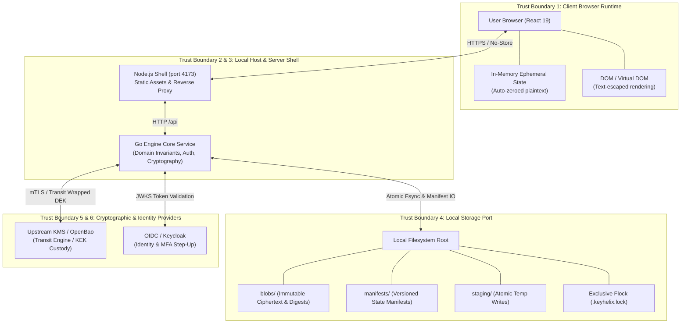

# KeyHelix Threat Model

## 1. System Overview & Scope

KeyHelix is an open-source, local-first secret management and cryptographic authorization platform designed according to [ADR-0003](file:///home/amirreza/Desktop/Projects/Keyhelix/docs/architecture/ADR-0003-open-source-local-first.md). It delivers zero-plaintext storage, hardware-backed envelope encryption, and verifiable cryptographic auditability without requiring paid cloud subscriptions or proprietary vendor lock-in.

This threat model defines the system trust boundaries, adversary model, STRIDE threat catalog, and security controls for the supported **KeyHelix Linux Local-First Profile** (Linux x86_64, Go 1.26, Node 24.19, React 19).

---

## 2. Trust Boundaries

| Boundary ID | Boundary Name | Description | Threats Crossing Boundary |
| --- | --- | --- | --- |
| **TB-1** | **Browser Client Runtime** | User agent execution environment running React 19. Plaintext secrets are held in memory only during transient reveal. | Malicious document import, DOM-based XSS, prototype pollution, memory inspection. |
| **TB-2** | **Web Shell / Proxy** | Local Node.js server serving bundled assets and routing requests. | Request forgery, header manipulation, directory traversal in static file server. |
| **TB-3** | **Go Engine Core** | Authoritative process enforcing authorization, step-up verification, encryption, and audit checkpoint signing. | Privilege escalation, bypass of step-up, unrevoked grant usage, session hijacking. |
| **TB-4** | **Storage Port** | Single-host file repository storing encrypted envelopes, immutable blobs, versioned manifests, and signed audit checkpoints. | Direct file manipulation, corrupted manifest, concurrency race conditions, unauthorized disk reading. |
| **TB-5** | **Upstream Key Provider (OpenBao)** | Custodian of Key Encryption Keys (KEKs). Performs cryptographic wrap/unwrap operations. | Provider offline/outage, compromised provider network, unauthorized KEK rotation. |
| **TB-6** | **Identity Provider (OIDC)** | Identity verification and step-up authentication authority. | Token forgery, replay attacks, expired identity tokens. |

---

## 3. Adversary Model

KeyHelix models three distinct classes of threat actors:
1. **Untrusted External Actor**: An actor with network access to local web endpoints or who supplies untrusted JSON files for inspection. Has no credentials or grants.
2. **Low-Privilege / Departing Insider**: A legitimate user (`vault-member`) whose access has been revoked or who attempts to access objects outside their authorized path scope (e.g. cross-tenant or admin vaults).
3. **Compromised Host / Storage Snooper**: An actor with read access to the local filesystem (e.g., inspecting crash dumps, temp files, or directory listings) attempting to extract plaintext secrets or forged audit records.

---

## 4. STRIDE Threat Catalog & Defenses

### 4.1 Spoofing (Identity & Role Impersonation)
- **Threat S1: Forged or Replayed OIDC / Step-Up Tokens**
  - *Risk*: An attacker captures or crafts a JWT/step-up token to reveal secrets without MFA.
  - *Mitigations*: Every step-up challenge requires cryptographic signature validation against issuer keys, verification of `exp`, `nbf`, `aud`, and `sub` claims, and monotonic challenge tracking that rejects token replays.
- **Threat S2: Header Forgery (`X-KeyHelix-Role`, `X-KeyHelix-StepUp`)**
  - *Risk*: Client injects custom HTTP headers to claim administrative privileges.
  - *Mitigations*: The Go engine ignores client-supplied role headers; roles and permissions are derived strictly from authenticated cryptographic tokens validated against the authoritative identity provider.

### 4.2 Tampering (Data & State Modification)
- **Threat T1: Envelope Ciphertext or Authentication Tag Tampering**
  - *Risk*: An attacker modifies encrypted blobs on disk to corrupt secrets or trigger side-channel oracle attacks.
  - *Mitigations*: Authenticated Encryption with Associated Data (AEAD) using AES-256-GCM or ChaCha20-Poly1305. Associated data binds the vault ID, secret path, and version. Any modification causes AEAD authentication failure (`CIPHERTEXT_AUTH_FAILED`) and returns zero plaintext.
- **Threat T2: Storage Manifest & Checkpoint Rewriting**
  - *Risk*: An attacker alters storage manifests to roll back to a revoked grant or deleted secret.
  - *Mitigations*: Storage manifests are monotonic and version-chained with SHA-256 digests. Audit logs are signed with Ed25519 checkpoints anchored in an independent sink. Tampered manifests or unanchored chains are rejected.
- **Threat T3: Path Traversal in Secret & Vault Identifiers**
  - *Risk*: Supplying paths such as `../../etc/passwd` or `app//prod/secret` to access arbitrary files.
  - *Mitigations*: Paths are sanitized with strict canonical checks (`path.Clean(name) == name`), rejecting `..`, `//`, absolute paths, or invalid characters before storage or provider access.

### 4.3 Repudiation (Audit & Action Deniability)
- **Threat R1: Tampering with Historical Audit Logs**
  - *Risk*: An insider deletes or modifies log records to conceal unauthorized secret reveal operations.
  - *Mitigations*: Audit events are structured as CloudEvents 1.0, hash-chained using cumulative SHA-256 digests, and periodically signed using Ed25519 checkpoints (`internal/audit/checkpoints.go`). Verifiers enforce monotonically increasing sequence numbers and sequence floors.

### 4.4 Information Disclosure (Plaintext Secret Leakage)
- **Threat I1: Secret Leakage in Metadata Lists, Logs, or Telemetry**
  - *Risk*: Plaintext secret bytes are included in secret list responses, debug logs, or error traces.
  - *Mitigations*: Complete architectural segregation between metadata and secret payloads (Requirement F14). Secret lists return only paths, versions, and digests. String formatting on secret structs renders `[REDACTED]`. The `security.AssertDirectoryClean` test suite asserts 0 occurrences of sentinels on disk.
- **Threat I2: Plaintext Persistence in Browser Memory or Storage**
  - *Risk*: Plaintext revealed in the UI persists in `localStorage`, `sessionStorage`, or indefinitely in DOM nodes.
  - *Mitigations*: The browser client strictly prohibits saving secrets to Web Storage. Plaintext is displayed transiently in memory, auto-zeroed on countdown timer expiration, and instantly cleared on Escape key press, modal close, or session logout (Requirement F15).
- **Threat I3: HTTP Caching of Sensitive Payloads**
  - *Risk*: Browsers or intermediate proxies cache reveal responses.
  - *Mitigations*: All sensitive endpoints emit `Cache-Control: no-store, no-cache, must-revalidate` and `Pragma: no-cache`.

### 4.5 Denial of Service (Resource Exhaustion & Crash Attacks)
- **Threat D1: JSON Preview Bombs (Depth, Size, Complexity)**
  - *Risk*: An attacker imports a crafted JSON file causing call-stack exhaustion, high CPU utilization, or memory exhaustion.
  - *Mitigations*: `inspectJson` enforces strict validation limits: 64 KiB maximum file size, depth limited to $\le 32$ levels, traversal count capped at 20,000 items. Exceeding limits aborts immediately with `Document is too complex to preview.`
- **Threat D2: Prototype Pollution Attacks**
  - *Risk*: JSON containing `__proto__`, `prototype`, or `constructor` modifies the global `Object.prototype`.
  - *Mitigations*: `inspectJson` checks every key against a forbidden identifier set (`new Set(['__proto__', 'prototype', 'constructor'])`). If found, parsing aborts immediately with `Unsafe document key.`

### 4.6 Elevation of Privilege (Access Control Bypasses)
- **Threat E1: Cross-Tenant Vault Access**
  - *Risk*: A member of `vault-prod` attempts to access `vault-isolated-finance`.
  - *Mitigations*: Scopes and tenant ownership are checked at the engine boundary before provider invocation. Unauthorized requests fail closed with `UNAUTHORIZED` (HTTP 403).
- **Threat E2: Stale Grant Usage After Revocation**
  - *Risk*: A revoked user attempts to use an active session to read secrets before session TTL expires.
  - *Mitigations*: Real-time, synchronous grant lookup (`grants.Service.AuthorizeMemberAccess`). Revocation invalidates grants immediately on the next request, resetting any active step-up sessions (`GRANT_REVOKED`).
- **Threat E3: Provider Outage Exploitation**
  - *Risk*: When OpenBao is unreachable, the system falls back to insecure cached defaults.
  - *Mitigations*: Fail-closed architecture. If OpenBao returns 503 or network errors, the engine aborts with `PROVIDER_UNAVAILABLE` and zero cached or placeholder secrets are returned.

---

## 5. Security Invariant Verification Mapping

| Invariant ID | Security Invariant | Verification Mechanism | Status |
| --- | --- | --- | --- |
| **INV-1** | **Provider owns secret bytes** | DEKs are wrapped with provider KEK. Raw DEKs and plaintext never hit disk or manifests. | Verified (C14, C26, C27) |
| **INV-2** | **Zero plaintext persistence & telemetry** | `AssertDirectoryClean` inspects all files, blobs, and manifests. HTTP requests verified with zero uploads. | Verified (C21, C26, C27) |
| **INV-3** | **Mandatory fresh step-up challenge** | Engine reveal endpoint requires valid step-up token; UI blocks reveal without token. | Verified (C21, C26, C27) |
| **INV-4** | **Immediate synchronous privilege revocation** | Revoking a grant immediately denies subsequent reads and invalidates step-up session. | Verified (C22, C26, C27) |
| **INV-5** | **Fail-closed on provider outage / corruption** | 503 from provider or invalid GCM tag fails closed with explicit error; zero cached data. | Verified (C24, C26, C27) |
| **INV-6** | **XSS & Prototype pollution defense** | React escapes all injected tags; `inspectJson` blocks forbidden keys and complexity bombs. | Verified (C27) |

---

## 6. Supported Profile & Deployment Boundaries

The security guarantees defined herein apply to the supported **KeyHelix Open-Source Local Delivery Profile**:
- Host OS: Linux x86_64 (kernel 5.15+)
- Engine: Single-host Go 1.26 binary managing exclusive storage lockfile (`.keyhelix.lock`).
- Network: Local loopback interface (`127.0.0.1`) with mTLS to self-hosted OpenBao and Keycloak.
- Deployments on public multi-tenant clouds or unsupported operating systems require separate validation per [ADR-0003](file:///home/amirreza/Desktop/Projects/Keyhelix/docs/architecture/ADR-0003-open-source-local-first.md).
